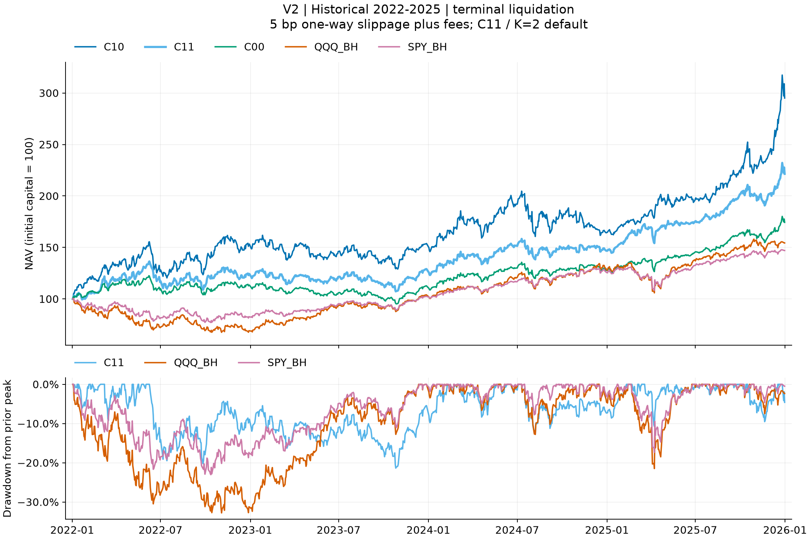
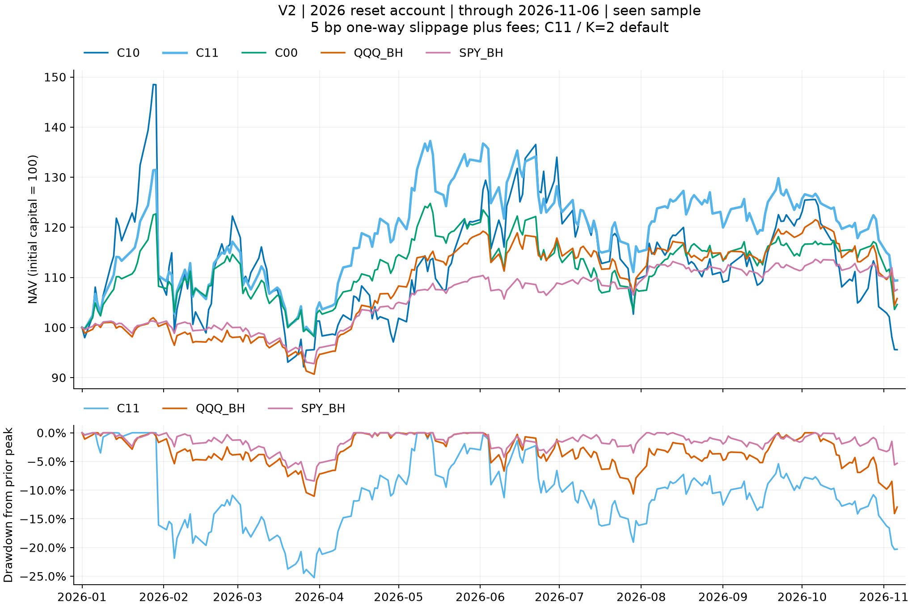

# ETF动量轮动：标准方案V2

**每月在2022年起点前规模资料重建的34只风险ETF中，按252日总回报动量选取ETF，同一经济风险组最多一只；SHY作门槛和防守。** 2026-11-10采用这两项作为标准。用户于2026-11-11明确选择 **C11前2只作为默认策略**，C10前1只和C00前3只保留为对照。该选择发生在看过历史结果之后，不构成新的样本外确认；没有新增年度换池。

[标准配置](standard/STRATEGY.json) · [完整规则与21组名单](docs/STANDARD_V2.md) · [离线复现](docs/REPRODUCE_V2.md) · [全部V2结果](standard/results/RESULTS.md)

新增独立研究记录：[真实月末13612W加权动量](experiments/calendar13612w/README.md)。2022–2025三个持仓版本均未优于同K原252日标准，2026前3只出现局部优势；完整结果和账本保留，标准V2规则不变。

后续[前2只的六个动量变种对照](experiments/top2-momentum-variants/README.md)也已归档：跳月、等权多周期、波动率／回归排名、正收益和均线门槛。本轮没有提高完整历史年化的版本；原标准保持不变，全部成本和不利结果公开。

**历史池仍是条件性重建，尚未证明无偏或可实盘。** 原2026名单倒用于2022存在选池时点前视风险；V2改用2022开始前的归档规模，但原95候选／类别设计仍来自后来的研究、规模资料不同步、退市覆盖不全。2026也已经看过，不能把本轮称作全新样本外。

## 2022–2025结果

相同50,000美元本金、95%目标部署、整股、税0、冻结佣金及单边5bp滑点；2025最后交易日开盘清仓。按年化排序。

|V2方案|累计收益|年化收益|完整最大收盘回撤|
|---|---:|---:|---:|
|C10：前1只，对照|195.06%|31.24%|22.55%|
|**C11：前2只，当前默认**|121.46%|22.11%|21.36%|
|C00：前3只，分组|74.36%|14.99%|22.32%|
|QQQ买持|54.36%|11.52%|32.79%|
|SPY买持|47.02%|10.17%|23.04%|
|SPY60／IEF40|25.33%|5.84%|19.80%|

原版C10的40.10%年化来自按2026规模建的旧36池，**不是V2收益**。完整旧数据和代码仍可通过[旧版说明](docs/V1_OVERVIEW.md)复现。



## 分组后的逐年收益／回撤

每格为净收益／该年最大收盘回撤，单位%；年初不重置本金。2026主列为当年新建50k账户，截至2026-11-06收盘，无期末强平。

|方案|2022|2023|2024|2025|2026至今|
|---|---:|---:|---:|---:|---:|
|C10前1|53.28／22.55|−0.17／20.27|7.44／21.49|79.47／11.99|−4.43／37.95|
|C11前2|24.32／20.23|3.21／16.83|14.36／12.62|50.92／10.76|9.39／25.25|
|C00前3|13.49／15.06|−1.19／17.72|13.88／11.57|36.53／9.14|4.59／19.94|
|QQQ买持|−30.88／32.79|49.77／10.05|23.84／12.78|20.41／21.48|5.78／14.09|
|SPY买持|−17.39／23.04|23.85／9.18|22.80／7.79|17.01／17.35|7.56／8.41|

**当前默认C11在2026收益9.39%，最大回撤25.25%；旧默认C10亏4.43%，回撤37.95%。** 更换默认不代表可靠性或实盘资格已获证明。K1只有一个风险槽，分组对它没有数学影响。历史池K2在2026分组后回撤由28.41%降到25.25%，但历史年化由26.62%降到22.11%；K3的完整历史回撤反而由20.57%升到22.32%。[完整配对数据](standard/evidence/paired_pool_group_metrics.csv)保留原池／历史池、分组／不分组与两档成本。

SPY／QQQ也是95%初始投入、分红留现金的同费账户，并非网站100%分红再投曲线；60/40指SPY与IEF，目标57%／38%加5%现金。完整回撤跨年延续高点，不能拿年度回撤最大值代替。



## 数据与复现

`standard/data/2025`和`standard/data/2026`提供35资产的两套物理截止数据；`standard/reference/`提供36固定账户的五类账本、真实原生收益与指标。`src/c10standard/`使用Backtrader原生订单／现金／Position／费用／TimeReturn，复用已验证公司行动适配，不另造撮合器。新增`src/c10experiments/`直接复用该执行核心，复现已登记的13612W与六个动量变种。旧`data/`、`src/c10share/`、`src/rotbt/`保留V1兼容入口。

```bash
python3.14 -m venv .venv
source .venv/bin/activate
python -m pip install -r requirements.lock
export PYTHONPATH=src
python -m c10standard.report
python -m c10standard.run --output runs/default_top2 --journal runs/standard_attempts.jsonl
# 全36标准账户另用 --all36，和上面的默认单账户二选一
```

运行时不需要API账号或私有目录。三种cohort严格区分：2022–2025末开盘清仓、2026年初重置、从2022连续运行的2026年度切片。[复现指南](docs/REPRODUCE_V2.md)解释完整检查、失败留证及输出字段。

旧版2.0发布验收与72次复现记录保留在[历史收据](standard/evidence/RELEASE_VERIFICATION.json)。本次2.1默认变更与完整测试公开使用独立验收记录，不把旧通过记录冒充新默认的验证。计算可复现不代表策略未来有效。

## 证据边界

基金池以AUM≥50亿美元建池；每次调仓另检查20日均成交额≥1000万美元。最终排名按252日总回报，而非规模或成交额。过去公司行动和派息用明确来源裁决，真实支付日后才可花分红；已批准冲突、来源hash与[历史AUM观察](standard/evidence/historical_candidates.csv)保留。

开盘全成交、税0及固定费用是模型假设；实际交易冲击、购买力、完整历史名单与未来独立观察仍未验证。新增标准没有自动修改旧前瞻链，也没有交易接口。代码GPL-3.0-or-later；市场数据第三方权利见[NOTICE](NOTICE.md)，不发布供应商完整网页、登录资料或账户数据。

## 新增测试与研究源码

- [原始9脚本、8测试模块及76测试函数清单](experiments/source_archive/INDEX.json)，原文与来源SHA保留；[归档依赖范围](experiments/source_archive/README.md)明确哪些属于原研究机集成测试。
- [原始测试与公开活跃测试的覆盖对应](experiments/source_archive/TEST_COVERAGE.json)列出未重新执行的供应商原始数据QA集成部分，不把归档测试计作公开环境测试通过。
- 活跃可执行测试在`tests/`，含当前默认、标准36账户资料、13612W和六变种、历史前缀、参考篡改、恢复和统计检验。
- [实验复现与全部测试指南](docs/EXPERIMENTS.md)：使用公开行情与账本复现54个已存在实验账户，无需私有研究目录或Futu账号。标准默认仍只运行C11原252方案。
