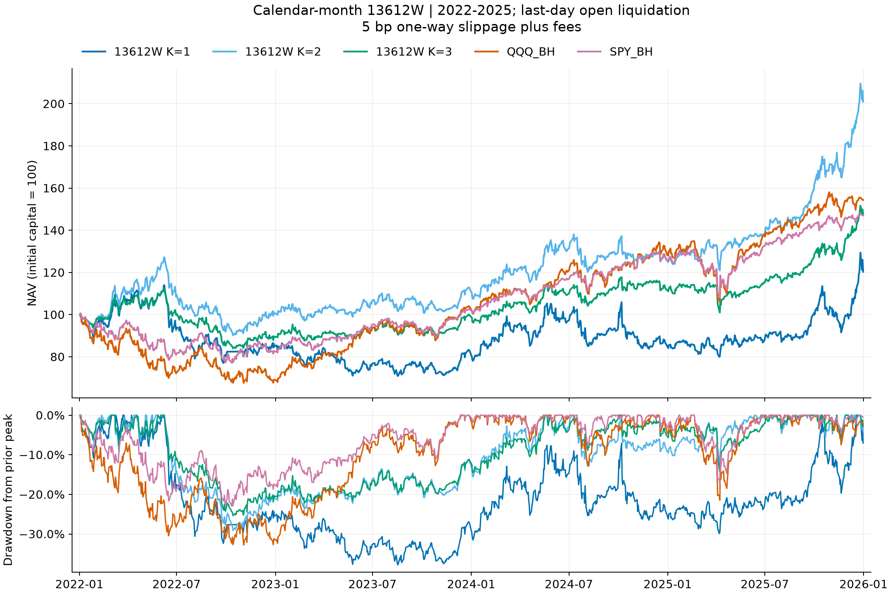
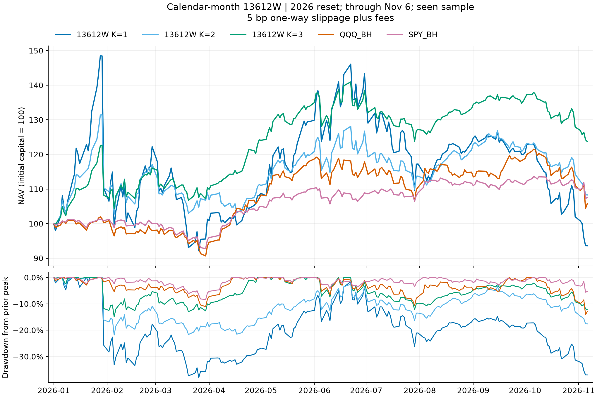

# 13612W真实月末加权动量：历史未优于252，2026前3只出现局部优势

2026-11-10。用户指定研究：历史规模重建ETF池、风险分组、持有1／2／3只，以SPY／QQQ等为基准，查看逐年收益与最大回撤。先于新收益计算冻结权重／口径／有限目录，再执行成熟Backtrader账户。本轮未更新标准V2或默认K1。

**结论：值得测试，但13612W没有显示普遍优于原252日评分。2022–2025，三个持仓数量的新版本年化更低、完整回撤更高、换手更多。前2只仍有19.16%年化的历史盈利表现；前3只在已见的2026显著改善（+23.73%／回撤14.91%），构成后续观察线索，不能据单个事后年度升为可靠冠军。前1只在主历史期和2026都表现较弱。**

## 冻结规则

- 按用户选择，1／3／6／12个月取真实日历月末的最后XNYS交易日，不用21／63／126／252交易日近似。`Rm=TR(t)/TR(向前m个日历月的最后交易日)−1`。
- `score=(12×R1+4×R3+2×R6+R12)/4`；除以4是统一缩放，不是权重和为1的归一化。统一缩放不影响排名或与同评分SHY的严格大小比较。近月信息在多个重叠窗口中被重复包含，12:4:2:1并非四段独立区间的贡献权重。
- 固定V2历史34风险ETF＋SHY，21风险组cap1；AUM≥50亿美元及类别代表只用于建池。每次月末另须253条观察、20日日均实际成交额≥1000万美元、20天均有成交、价格≥5美元。
- 全局评分降序／代码升序，贪心跳过已占组，选K槽后逐个严格超过SHY同13612W评分；失败槽转SHY，无递补、无额外正收益／均线过滤。每风险槽预部署90%÷K，全组合再乘95%一次，50k初始资金、整股、税0、原费用与单边5／20bp滑点。
- 月末收盘决策、次交易日开盘执行；原生Backtrader撮合与账户，沿用真实支付日及既有最小拆股适配，无新止损或自建收益引擎。该试验仅替换动量评分，不是完整FAA／PAA／VAA策略复刻。

两种评分的比较包含“多窗口权重＋日历跨度”的整体变化。真实12个月并不总等于252交易日，例如2025-12-31回看2024-12-31只有250个交易间隔，不能把差异全部归因近月权重。

## 主历史结果：2022–2025

每格为“净收益／最大收盘回撤”，单位%。年度本金和持仓连续，回撤包含年初资本。2025末按原研究约定最后交易日开盘清仓；完整回撤跨年保留高点。初始50k，5bp每边加固定费用；SPY／QQQ初始95%投入、分红留现金，60／40为SPY／IEF目标57%／38%加5%现金。

按完整期年化排序展示新策略与基准：

|方案|2022收益／回撤|2023收益／回撤|2024收益／回撤|2025收益／回撤|
|---|---:|---:|---:|---:|
|13612W前2|0.48%／29.14%|11.69%／8.49%|11.79%／12.94%|60.17%／10.78%|
|QQQ买持|-30.88%／32.79%|49.77%／10.05%|23.84%／12.78%|20.41%／21.48%|
|13612W前3|-10.73%／25.38%|11.51%／8.11%|12.01%／8.89%|32.08%／12.29%|
|SPY买持|-17.39%／23.04%|23.85%／9.18%|22.80%／7.79%|17.01%／17.35%|
|SPY60／IEF40|-15.69%／19.80%|15.64%／7.81%|13.21%／4.10%|13.55%／9.92%|
|13612W前1|-15.15%／32.38%|-2.62%／17.95%|2.87%／20.89%|41.57%／19.38%|

|方案|累计收益|年化收益|完整最大回撤|Sharpe rf=0|20bp年化收益|期末资产|
|---|---:|---:|---:|---:|---:|---:|
|13612W前2|100.94%|19.16%|29.14%|1.009|16.93%|$100,468.33|
|QQQ买持|54.36%|11.52%|32.79%|0.606|11.46%|$77,181.34|
|13612W前3|47.27%|10.21%|25.38%|0.674|8.02%|$73,635.99|
|SPY买持|47.02%|10.17%|23.04%|0.666|10.10%|$73,512.36|
|SPY60／IEF40|25.33%|5.84%|19.80%|0.579|5.72%|$62,666.49|
|13612W前1|20.33%|4.76%|37.81%|0.309|2.52%|$60,164.15|

13612W前2在该历史期的收益高于SPY／QQQ，但2022几乎没有净收益（+0.48%）却经历29.14%回撤，2025+60.17%是重要收益年份。前3的年化10.21%几乎等于SPY10.17%，回撤25.38%高于SPY23.04%；20bp时前3年化降到8.02%。前1在2022、2023连续亏损，全期年化仅4.76%、回撤37.81%。这些不支持集中持有13612W第一名是更好的默认。

## 同池、同分组、同K，与原252日评分配对

|持仓数量|年化：原252→13612W|完整回撤：原252→13612W|四年换手倍数：原252→13612W|订单数：原252→13612W|显式费用：原252→13612W|
|---|---:|---:|---:|---:|---:|
|前1|31.24%→4.76%|22.55%→37.81%|23.28→56.12|102→117|$454.07→$637.89|
|前2|22.11%→19.16%|21.36%→29.14%|27.39→48.23|161→190|$595.58→$779.48|
|前3|14.99%→10.21%|22.32%→25.38%|27.92→51.83|217→271|$617.45→$812.82|

换手定义为期间绝对成交金额之和／平均收盘NAV，包含买卖双边，不是年化或证券替换次数。三种新版本换手分别约原版2.41／1.76／1.86倍。费用列仅显式佣金等，滑点已体现在成交和净收益里，不包含在该费用列。

原252前1在2022收益+53.28%，13612W前1为−15.15%。新评分年初选VNQ，随后在XLE、PDBC、MCHI、BIL等之间切换；2022账面利润分解为VNQ约−3743美元、MCHI−3616、XLE−2960、PDBC+2923、SHY−195、BIL+17。更快跟踪近期走势也会离开长期强势资产后再追入，这条真实路径与反复换仓损失一致，不能仅靠“反应更快”推断更稳。资产利润为财务分解，不是独立因果效应。

2023、2024的部分K2/K3年度回撤更小，因此不是每个年份都全面落后；但预先固定的2022–2025完整期上，三个K均未实现比原252更高收益或更低最大回撤。

## 2026辅助结果：年初新建账户

截止2026-11-06，共214个交易日。下列为累计YTD，非全年／年化；没有期末强平。

|方案|2026累计收益|最大收盘回撤|20bp累计收益|
|---|---:|---:|---:|
|13612W前3|23.73%|14.91%|21.92%|
|13612W前2|8.30%|21.86%|6.87%|
|SPY买持|7.56%|8.41%|7.42%|
|QQQ买持|5.78%|14.09%|5.63%|
|SPY60／IEF40|4.06%|5.59%|3.89%|
|13612W前1|-6.41%|37.95%|-7.75%|

|持仓数量|2026收益：原252→13612W|2026回撤：原252→13612W|
|---|---:|---:|
|前1|-4.43%→-6.41%|37.95%→37.95%|
|前2|9.39%→8.30%|25.25%→21.86%|
|前3|4.59%→23.73%|19.94%→14.91%|

前3只2026确实明显改善，20bp仍有+21.92%，不是仅靠低成本假设才为正。同期前2只收益略低于原252，但回撤更小；前1只亏损更多，约37.95%的回撤基本没有改善。这说明效果依赖持仓数量和年份，不能概括为13612W普遍更好。

## 连续运行到2026的年度切片

从2022原生运行，2025末不清仓，2026分母取各账户自身2025-12-31收盘NAV。它与主历史账户在2025末的结算时点不同，不能把主历史末开盘余额拼接来算。

|方案|2026连续账户收益|2026最大回撤|20bp连续账户收益|
|---|---:|---:|---:|
|13612W前3|26.53%|14.93%|24.76%|
|13612W前2|10.53%|21.87%|9.03%|
|SPY买持|7.99%|8.22%|8.00%|
|QQQ买持|6.79%|14.13%|6.80%|
|SPY60／IEF40|4.40%|5.63%|4.39%|
|13612W前1|-2.72%|37.95%|-3.88%|

两种起点均显示2026前3只相对优势；这避免只挑一个较好的启动状态，但两个口径仍使用相同市场历史，不是两份独立未来证据。

## 2026前3只改善来自哪里

- 2026年初仍选SLV＋SOXX＋VEA，与原252分组前3的初始组合相同。1月30日急跌当天仍跌11.79%；前1／2只当天仍跌25.73%／16.08%。13612W并没有提前避开这次白银暴跌。
- 到3月31日决策，13612W前3目标改为PDBC＋XLE＋SOXX；4月账户收益+12.51%。后续在半导体、商品、能源及其他组之间切换，全年轨迹与252不同。
- 前3只2026新账户净利润约11,863美元，主要财务贡献为SOXX约+5667、PDBC+3162、XLE+1767、VGT+1226；SLV净贡献约+211。收益集中在少数资产及具体持有时段，不能称无条件广泛alpha。

上述归因包含持仓漂移、再平衡、交易和费用的实际账面影响。没有新增“去掉某基金重跑”等反事实实验，不把美元贡献直接当因果证明。

## 验证与局限

先冻结计划／目录`2de877e1`，实现`8a7685ae`，再真实运行20个账户（2桥＋18科学），20完成0失败。36旧账户作为明确复用控制，合计54报告角色，不计作36次新发现。独立hard28预算含失败；本轮无行情API、账户或订单接口调用。

39项纯信号／报表／输入回归测试通过，typeguard启用；strictmypy81源、Pyright及Ruff通过，150条依赖弃用告警保留。测试覆盖真实月末假日、不同月份交易日数量、缺失精确端点、未来隔离、同组跳过、SHY固定槽、失败计数和恢复。两桥逐五账本／信号／真实原生收益／开放Trade／指标与V2参考相同；正式账户独立核rawTR评分、月末日历、价格／费用、分红权利与支付、拆股、现金／持仓／NAV、原生TimeReturn。

- 历史池是原95候选内的条件性AUM重建，仍继承后来的类别设计，规模日期异步、幸存覆盖不全。没有声称完全PIT。
- 2022–2026均已有研究暴露；固定这次方案能限制本轮追结果调参，但不能抹去此前多轮尝试或把2026重新变成未见OOS。
- 未在本轮计算多重检验校正或统计显著性；不能把年化高于基准当作可靠未来超额。
- 原生开盘全量成交、固定费用、无税、无真实盘口冲击等限制沿用。自定义仅信号、必要适配与独立核验，未另造撮合／收益引擎。

## 研究判断与后续边界

|版本|本轮证据|判断|
|---|---|---|
|13612W前1|历史年化4.76%、回撤37.81%；2026仍亏6.41%|当前证据弱，不支持替换标准前1|
|13612W前2|历史年化19.16%高于SPY/QQQ，但弱于原252前2且完整DD更大；2026较温和|可保留固定候选观察，尚无相对原版的稳定优势|
|13612W前3|历史年化约等于SPY、弱于原252；2026收益和回撤均明显改善|存在值得观察的局部线索，不能凭已见2026选冠军|

保留标准V2和本轮固定方案，不根据结果改权重、窗口、K或调仓日。若继续验证，应预登记未来观察或一个明确机制假设；不要在同一2026样本上反复调到漂亮结果。

## 公开研究记录的范围

本目录是独立实验结果与账本快照，**没有修改标准V2，也没有给标准CLI新增13612W入口**。`python -m c10standard.run`仍运行原252日标准。13612W本地研究脚本及其旧研究依赖未包含为便携CLI，本目录不能声称从行情一键重新模拟13612W。

公开资料足以从每日NAV重新计算收益/回撤、从TR与月末目标核对13612W排名，也保留全部18新账户的五类账本、目标和指标。原252/SPY/QQQ/60-40参考在[standard/reference](../../standard/reference/)，相同35资产行情在[standard/data](../../standard/data/)，标准池/分组在[STRATEGY.json](../../standard/STRATEGY.json)。

- [逐年／累计指标](PERIOD_METRICS.csv)、[54角色汇总](SUMMARY.csv)、[月收益](MONTHLY.csv)、[同K配对比较](PAIRED_COMPARISON.csv)。
- [资产利润分解](ASSET_PROFIT_5BP.csv)、[目标仓位](TARGET_WEIGHTS_5BP.csv)、[1月30日核验](JAN30_CHECK_5BP.csv)。
- [18新账户与文件SHA256](ACCOUNTS.json)、[来源与核验摘要](VERIFICATION.json)。仅数据与报告发布，不升级默认策略。
