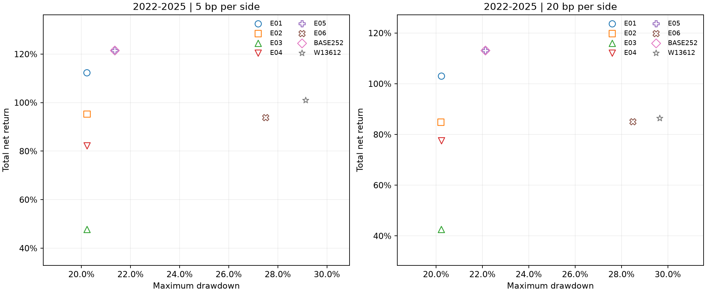
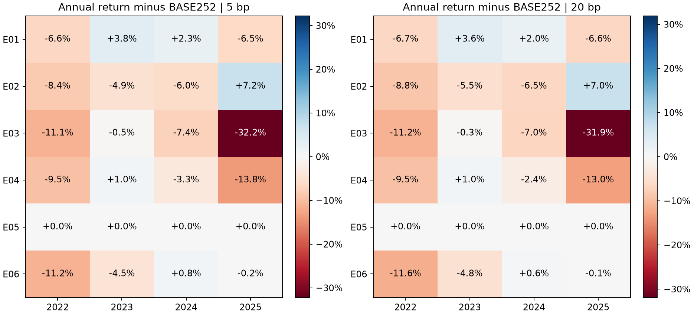

# V2前2只的六个动量变种：没有新增高收益优势，留下有限风险取舍

> 本页保留该实验完成时的研究结果与判断。2026-11-11已补齐公开复现入口和测试，见[实验指南](../../docs/EXPERIMENTS.md)；当前标准默认由用户选择为C11前2只。下方原“未提供便携CLI”说明仅适用于当时快照。

2026-11-10执行。用户要求继续探索经典动量变种；本轮先盘点既有研究，再固定历史34风险ETF＋SHY、21组、每组最多一只、只持前2只，逐一改变六个机制。没有组合参数、扩大持仓数量、优化年份或自动替换标准V2。

**主要结论：六个改动均未提高2022–2025完整年化收益；没有一个在5／20bp两档成本下同时达到“年化不低于原版、完整最大回撤不高于原版且至少一项更好”。E01跳过最近21天最接近原版，是小幅收益／回撤取舍；E03波动率调整明显降低整体波动但牺牲大量历史收益；E05与原版所有六条路径完全相同，不是一项新成功。2026局部更好的结果不足以推翻这些历史反证。**

当前主观察仍可保留V2原252前2只。本轮没有证明其未来可靠，也没有否定所有可能的动量策略；只对这六个预登记变种给出完整证据。

## 六个机制及公平比较

|ID|独立改动|排序分数|选出两个风险组之后的门槛|
|---|---|---|---|
|E01|跳过最近21交易日|TR[t−21]/TR[t−252]−1|相同skip分数严格超过SHY|
|E02|1／3／6／12月等权|(R1+R3+R6+R12)/4；真实日历月末|相同等权分数严格超过SHY|
|E03|波动率调整排名|R252/max(63日日收益样本标准差×√252,1%)|保持原R252严格超过SHYR252|
|E04|回归趋势排名|252×最近252个logTR价格的OLS斜率×R²|保持原R252严格超过SHYR252|
|E05|增加正收益要求|原R252|R252>max(SHYR252,0)|
|E06|增加长期均线要求|原R252|R252>SHYR252，且TR当前>最近200日TR均值|

E03只改变排序，不同时改为逆波动率配仓或更换防守门槛。E04保留负斜率符号，常数序列分数为0。E01采用交易日近似12−1，不冒真实日历12−1；E02则与此前13612W使用同样真实月末端点，因此对13612W的差异主要是权重，对252的差异还包含日历跨度。

全部沿原流动性／资格：至少253条观察、未复权收盘≥5美元、20日日均实际成交额≥1000万美元且每天成交量>0。全局排名、同组跳过，先固定两个名额，再检查门槛；失败槽转SHY，不递补、不放大另一个槽。每风险槽预部署45%，组合乘95%一次，初始名义每只42.75%、SHY9.5%、现金约5%；权重随行情漂移。50k、原费用、整股、税0、月末收盘→下一交易日开盘，Backtrader原生全量成交模型。

旧C06／C08／C09／C21曾在旧36池／前3／2022–2024开发期研究，这次是有条件迁移对照，不是六项全新独立发现。完整[旧覆盖盘点](PRIOR_COVERAGE.json)保留。

## 主期2022–2025：按年化收益排列

5bp为单边不利滑点，另计固定费用；表内回撤为每日收盘净资产最大损失幅度。2025最后交易日开盘终期清仓；其它年末连续持有、不重置本金。年化按252个交易日换算。SPY／QQQ初始95%投入、分红留现金，60／40目标57%SPY＋38%IEF＋5%现金，与轮动不保证同风险。

|方案|累计收益|年化收益|完整最大回撤|年化波动|20bp年化|
|---|---:|---:|---:|---:|---:|
|E05增加正收益门槛|121.46%|22.11%|21.36%|19.53%|20.94%|
|V2原252／前2|121.46%|22.11%|21.36%|19.53%|20.94%|
|E01跳过最近21天|112.28%|20.82%|20.23%|19.55%|19.47%|
|13612W加权／前2|100.94%|19.16%|29.14%|19.22%|16.93%|
|E02四周期等权|95.25%|18.31%|20.23%|20.02%|16.69%|
|E06增加200日均线门槛|93.80%|18.09%|27.51%|18.64%|16.72%|
|E04回归趋势排名|82.17%|16.26%|20.23%|18.63%|15.51%|
|QQQ买持|54.36%|11.52%|32.79%|21.99%|11.46%|
|E03波动率调整排名|47.70%|10.29%|20.23%|13.74%|9.31%|
|SPY买持|47.02%|10.17%|23.04%|16.62%|10.10%|
|SPY60／IEF40|25.33%|5.84%|19.80%|10.80%|5.72%|

E05与BASE252是相同经济路径，表中保留是为了完整披露六方案，不能当两次有效验证。各版本的收盘回撤20%左右也不能当作未来损失上限。

## 逐年收益

为避免“收益／回撤”合并格造成误读，这里分两张表。以下均为5bp成本实际年度净收益，非年度折算年化。

|方案|2022|2023|2024|2025|
|---|---:|---:|---:|---:|
|E05增加正收益门槛|+24.32%|+3.21%|+14.36%|+50.92%|
|V2原252／前2|+24.32%|+3.21%|+14.36%|+50.92%|
|E01跳过最近21天|+17.76%|+6.98%|+16.65%|+44.46%|
|13612W加权／前2|+0.48%|+11.69%|+11.79%|+60.17%|
|E02四周期等权|+15.94%|-1.73%|+8.40%|+58.09%|
|E06增加200日均线门槛|+13.13%|-1.30%|+15.12%|+50.77%|
|E04回归趋势排名|+14.80%|+4.19%|+11.06%|+37.13%|
|QQQ买持|-30.88%|+49.77%|+23.84%|+20.41%|
|E03波动率调整排名|+13.20%|+2.74%|+6.97%|+18.71%|
|SPY买持|-17.39%|+23.85%|+22.80%|+17.01%|
|SPY60／IEF40|-15.69%|+15.64%|+13.21%|+13.55%|

## 逐年最大回撤

年度高点从该年期初资本重置，完整期则跨年延续高点，两种回撤不能混用。

|方案|2022|2023|2024|2025|
|---|---:|---:|---:|---:|
|E05增加正收益门槛|20.23%|16.83%|12.62%|10.76%|
|V2原252／前2|20.23%|16.83%|12.62%|10.76%|
|E01跳过最近21天|20.23%|14.79%|16.55%|10.79%|
|13612W加权／前2|29.14%|8.49%|12.94%|10.78%|
|E02四周期等权|20.23%|13.56%|14.65%|10.77%|
|E06增加200日均线门槛|20.23%|15.20%|12.65%|10.79%|
|E04回归趋势排名|20.23%|10.81%|13.37%|13.83%|
|QQQ买持|32.79%|10.05%|12.78%|21.48%|
|E03波动率调整排名|20.23%|7.36%|2.70%|5.33%|
|SPY买持|23.04%|9.18%|7.79%|17.35%|
|SPY60／IEF40|19.80%|7.81%|4.10%|9.92%|

E01／E02／E03／E04完整回撤都约20.23%，不是误复制：它们在2022年5月末均选择XLE＋PDBC，共同高点为2022-06-08，低点为09-26，随后路径不同。经济分组仍允许能源股票与广义商品同时入选，两者可有共同风险。E06虽然加了均线门槛，跨年完整回撤反而达到27.51%；减少某些风险仓并不保证每条实现路径的最大回撤都会减少。

## 收益和交易成本的取舍

|方案|2022–25显式费用|订单数|期间换手倍数|相对原版四年收益更高的年份数|
|---|---:|---:|---:|---:|
|V2原252／前2|$595.58|161|27.39|—|
|E01跳过最近21天|$639.63|164|30.00|2|
|E02四周期等权|$632.00|175|36.72|1|
|E03波动率调整排名|$439.85|143|24.55|0|
|E04回归趋势排名|$440.27|151|16.73|1|
|E05增加正收益门槛|$595.58|161|27.39|0|
|E06增加200日均线门槛|$568.54|156|31.30|1|
|13612W加权／前2|$779.48|190|48.23|—|

期间换手＝绝对买卖成交额之和／平均收盘NAV，包含双边，不是年化换手。费用列不包含已计入成交价格的滑点。

- **E01跳过最近21天：** 年化20.82%对原22.11%，完整回撤20.23%对21.36%。2023／2024收益更好，2022／2025更差；最差年度收益由3.21%提高到6.98%。换手略增，并非降成本优化。可作为固定旁观版本，未证明优于原版。
- **E03波动率调整：** 年化从22.11%降至10.29%，年化波动从19.53%降至13.74%。在48个历史决策中BIL入选26次，资产选择明显向低波动倾斜，但完整最大回撤只从21.36%小降至20.23%。更平稳的日波动不等于高收益或显著降低尾部损失，不适合作为本轮收益优先的替代。
- **E04回归趋势：** 换手16.73倍对27.39倍较低，但年化16.26%明显少于原版22.11%；没有形成收益增强证据。
- **E05正收益门槛：** 两档成本和三种起点的全部6条目标与NAV都与原版相同。说明这批样本中附加条件未改变实际选择，不说明这个条件在任何未来路径都冗余。
- **E02等权多周期、E06均线过滤：** 没有在完整历史期实现收益和风险的共同改进。E02还在2026出现负收益；不把“多周期一定稳健”或“均线必能控制回撤”当作已证明事实。

图中年度收益差以比例表示，可解释为百分点差；不是相对收益百分比。E05和BASE252点重合是同路径事实。

## 2026已见样本：年初新投入50k

截止2026-11-06，共214交易日，期末收盘估值、无强平。这里是累计YTD，不能外推成全年或年化。

|方案|2026净收益|2026最大回撤|20bp净收益|
|---|---:|---:|---:|
|E03波动率调整排名|+13.32%|18.03%|+12.44%|
|E01跳过最近21天|+13.23%|25.25%|+12.32%|
|E04回归趋势排名|+9.51%|25.25%|+8.92%|
|E05增加正收益门槛|+9.39%|25.25%|+8.57%|
|V2原252／前2|+9.39%|25.25%|+8.57%|
|13612W加权／前2|+8.30%|21.86%|+6.87%|
|E06增加200日均线门槛|+7.57%|25.25%|+6.54%|
|SPY买持|+7.56%|8.41%|+7.42%|
|QQQ买持|+5.78%|14.09%|+5.63%|
|SPY60／IEF40|+4.06%|5.59%|+3.89%|
|E02四周期等权|-4.67%|27.49%|-5.91%|

E01在2026比原版收益高约3.84个百分点，但最大回撤同为25.25%；E03收益13.32%、回撤18.03%更有利，却不能抵消其2022–2025长期收益大幅降低的事实。2026已经见过，不能凭这一年更好就挑新的冠军。

## 2026辅助：从2022连续运行

以各账户自身2025-12-31收盘NAV为2026分母，2025没有终期清仓；新建与连续两口径不择优展示。

|方案|2026净收益|最大回撤|20bp净收益|
|---|---:|---:|---:|
|E01跳过最近21天|+16.97%|25.28%|+16.19%|
|E03波动率调整排名|+14.31%|18.06%|+13.10%|
|E05增加正收益门槛|+13.05%|25.26%|+12.47%|
|V2原252／前2|+13.05%|25.26%|+12.47%|
|E04回归趋势排名|+13.02%|25.27%|+12.69%|
|E06增加200日均线门槛|+11.08%|25.25%|+10.44%|
|13612W加权／前2|+10.53%|21.87%|+9.03%|
|SPY买持|+7.99%|8.22%|+8.00%|
|QQQ买持|+6.79%|14.13%|+6.80%|
|SPY60／IEF40|+4.40%|5.63%|+4.39%|
|E02四周期等权|-1.72%|27.52%|-2.64%|

## 局部多重比较与因果时间核验

统计在完整1003交易日2022–2025、两档成本分别计算，六个方案全部保留在同一族中，固定循环块重采样B=10000、block=5／20／60。复用已验证`rotbt.statistics.max_bootstrap`，各列与同成本BASE252的每日净收益相减；报告的是**年化算术平均日超额**及其pointwise95%区间，不是CAGR差区间，也不是同时置信区间。

这批六列的观察均值都≤0，且E05严格为零列；因此中心化bootstrap最大值始终≥0，本轮正向优势检验的adjusted_p全部为1。这是该单侧检验与样本的结果，**不能解释为“各方案完全无差别”或“所有动量策略无效”**。例如E03的pointwise区间低于零，反映其历史收益劣势；该区间未作同时覆盖校正。没有一个变种满足预定跨3块长度×2成本全部adjusted_p<0.05的局部正向支持要求。

此次局部六族校正没有消除过去大量策略／基金池／年份选择的总体试错偏差，也不构成新的独立样本外确认。[STATISTICS.csv](STATISTICS.csv)完整保留36行，不挑较好块长度。

在新native收益运行前，实际执行59个注册月末的原始价格前缀重算：354组变种目标full／prefix／独立raworacle一致，所有使用特征最大差异0；物理2025特征也与相同前缀一致。这直接支持“在既定规范数据上，后续行情不改变过去信号”，并不排除选池时点或供应商历史修订问题。它不是额外D−1收益压力测试，后者尚未在本轮新增。

## 执行与证据边界

新科学36账户＋两固定BASE252前2桥，共38实际启动、38完成、0失败，独立硬上限48。旧控制30账户明确复用，合66报告角色，不把复用账户／同路径当作新的独立成功。两桥targets、五账本、实际native收益向量／标量、openTrade和指标与V2精确一致。

源码与测试在收益前冻结，根执行38项合并回归＋1项新增前缀反例，共39个不同测试通过；typeguard、strictmypy81源、Pyright和Ruff通过，依赖弃用告警保留。全部native来自原Backtrader入口，未写新撮合或账户引擎。完整收据1459对象与源码961项哈希保持不变。报告154期间、66汇总、1540月收益、168双基准配对、36统计行、12Pareto描述、66路径登记全部保留。

仍有条件历史池、已见2026和反复研究选择偏差；税0、固定费用、开盘全量成交、实际购买力／盘口冲击未验证。上述计算验证不等于供应商全部事实正确或获准实盘。本轮未修改公开标准V2默认前1、旧前瞻链、原数据，也没有行情API、交易账户或下单调用。

## 当前判断

|研究位置|方案|理由|
|---|---|---|
|继续作为主要观察对象|V2原252前2|本轮收益最高，尚无新的同K优势版本；不是未来有效性的最终证明|
|可保留一个固定旁观版本|E01跳过最近21天|历史收益略低／完整回撤略小，2026收益较好，收益优先下不能直接替换|
|另有风险取舍，非收益增强|E03波动率调整、E04回归排名|分别降低整体波动／换手，但牺牲历史收益|
|没有新增经济路径|E05正收益门槛|本轮与原版精确同路径|
|暂不优先推进|E02等权多周期、E06均线过滤|没有共同收益／风险改善，部分关键期间更差|

此前13612W前3只在2026的局部优势没有被本轮前2只研究否定或升级；这是不同持仓数量的另一条已登记线索。本轮有限研究收敛，不继续根据这段已见历史拼接六种机制或调门槛。下一证据更适合冻结少量候选做真实前瞻，或者单独登记一个执行／数据疑点验证。

## 公开证据范围

这是独立研究的结果与账本快照，标准V2规则未改变，也没有给`c10standard.run`新增六变种入口。本地研究适配依赖尚未打包为公开便携CLI，不能宣称本目录可直接一键从行情重跑六变种。

[36新账户的五账本、目标、指标和文件哈希](ACCOUNTS.json)用于独立复算；30旧控制来自[标准参考](../../standard/reference/)及[13612W前2实验参考](../calendar13612w/reference/)。相同35资产行情见[standard/data](../../standard/data/)，池与分组见[STRATEGY.json](../../standard/STRATEGY.json)。

- [逐年／累计指标](PERIOD_METRICS.csv)、[66汇总](SUMMARY.csv)、[月收益](MONTHLY.csv)、[双评分基准配对](PAIRED_COMPARISON.csv)。
- [统计检验](STATISTICS.csv)、[共同改善描述](PARETO.csv)、[重复路径](SAME_PATH.csv)、[旧研究覆盖](PRIOR_COVERAGE.json)。
- [来源与核验摘要](VERIFICATION.json)、[前缀重算记录](CAUSALITY.json)。该前缀测试只支持给定数据下的因果时间隔离，不消除历史选池偏差。
