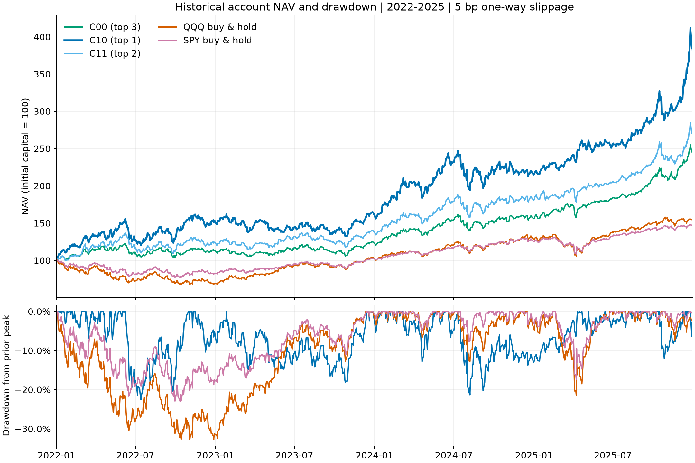
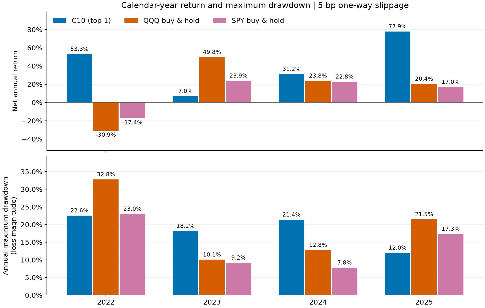
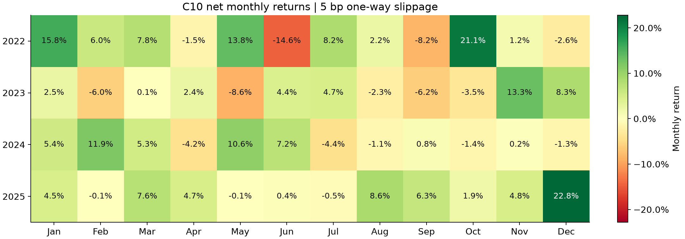

# C10 历史账户结果（2022–2025）

**这是条件性历史研究，不是可部署策略或未使用的样本外验证。** C10 是已比较的规则族中的候选；资产池使用当前规模筛选，存在当前 AUM 与存活偏差。原生 Backtrader 账户结果仅说明这些数据、规则和成本假设下的历史表现，不保证未来收益。

所有账户使用相同 2022-01-03 至 2025-12-31 窗口、初始资金 $50,000、95% 目标部署预算。价格变化导致持仓权重漂移，实际投资比例可超过 95%。收益含现金分红并扣交易费用与滑点；不含税、未使用现金利息。5 bp 为默认单边滑点，20 bp 为压力情景，均另计费用。QQQ/SPY 为同账户假设下的买入持有，非指数公布收益。

年度收益 = 年末权益 / 上年末权益 − 1；首年分母为任务配置初始资金。年度最大回撤从年度期初资金开始测量，跨年历史回撤见下表；均以正数表示损失幅度。Sharpe 采用日收益、无风险利率 0、样本标准差；波动率乘 √252；全期 CAGR 按 252/交易日数折算（1003 天），不能代替实际年度收益。

## 全期比较：默认 5 bp

| 策略 | 累计收益 | CAGR | 最大回撤 | 年化波动 | Sharpe | 期末权益 |
|---|---:|---:|---:|---:|---:|---:|
| C10 | 282.71% | 40.10% | 22.55% | 26.48% | 1.407 | $191,354.16 |
| C11 | 169.16% | 28.24% | 20.25% | 21.04% | 1.288 | $134,582.08 |
| C00 | 144.85% | 25.23% | 15.08% | 17.31% | 1.387 | $122,425.21 |
| QQQ_BH | 54.36% | 11.52% | 32.79% | 21.99% | 0.606 | $77,181.34 |
| SPY_BH | 47.02% | 10.17% | 23.04% | 16.62% | 0.666 | $73,512.36 |
| SPY60_IEF40 | 25.33% | 5.84% | 19.80% | 10.80% | 0.579 | $62,666.49 |

## 全期比较：20 bp 单边滑点压力情景

| 策略 | 累计收益 | CAGR | 最大回撤 | 年化波动 | Sharpe | 期末权益 |
|---|---:|---:|---:|---:|---:|---:|
| C10 | 274.26% | 39.32% | 22.54% | 26.44% | 1.387 | $187,131.03 |
| C11 | 161.56% | 27.33% | 20.21% | 21.02% | 1.255 | $130,782.37 |
| C00 | 135.40% | 24.00% | 15.05% | 17.30% | 1.330 | $117,697.83 |
| QQQ_BH | 54.00% | 11.46% | 32.83% | 22.02% | 0.603 | $77,001.04 |
| SPY_BH | 46.68% | 10.10% | 23.07% | 16.64% | 0.661 | $73,339.59 |
| SPY60_IEF40 | 24.78% | 5.72% | 20.00% | 10.80% | 0.569 | $62,392.07 |

## 各年 C10 / QQQ / SPY 对照：默认 5 bp

| 年度 | C10 收益 | C10 回撤 | QQQ 收益 | QQQ 回撤 | SPY 收益 | SPY 回撤 |
|---|---:|---:|---:|---:|---:|---:|
| 2022 | 53.28% | 22.55% | -30.88% | 32.79% | -17.39% | 23.04% |
| 2023 | 6.99% | 18.17% | 49.77% | 10.05% | 23.85% | 9.18% |
| 2024 | 31.15% | 21.39% | 23.84% | 12.78% | 22.80% | 7.79% |
| 2025 | 77.93% | 11.99% | 20.41% | 21.48% | 17.01% | 17.35% |

## C10 年度账户明细：默认 5 bp

| 年度 | 期初权益 | 期末权益 | 净利润 | 收益 | 最大回撤 | Sharpe | 波动率 | 订单 | 费用 |
|---|---:|---:|---:|---:|---:|---:|---:|---:|---:|
| 2022 | $50,000.00 | $76,642.13 | $26,642.13 | 53.28% | 22.55% | 1.578 | 30.07% | 22 | $52.61 |
| 2023 | $76,642.13 | $81,998.84 | $5,356.71 | 6.99% | 18.17% | 0.425 | 21.37% | 25 | $62.46 |
| 2024 | $81,998.84 | $107,544.80 | $25,545.96 | 31.15% | 21.39% | 1.072 | 29.32% | 23 | $61.60 |
| 2025 | $107,544.80 | $191,354.16 | $83,809.36 | 77.93% | 11.99% | 2.527 | 24.16% | 30 | $276.18 |

## C10 最大历史回撤

| 单边滑点 | 回撤 | 峰值日期 | 谷值日期 | 恢复峰值日期 | 峰值至恢复交易日 |
|---|---:|---|---|---|---:|
| 5 bp | 22.55% | 2022-06-08 | 2022-07-14 | 2022-10-31 | 100 |
| 20 bp | 22.54% | 2022-06-08 | 2022-07-14 | 2022-10-31 | 100 |

## 图表

## 复核与数据口径

已校验 108 个来源文件 SHA-256；独立复算 12 个账户的 84 个时期、840 个指标值，与归档 metrics.json 在 1e-10 容差内一致。另检验年度和月度收益连乘等于全期收益，所有日期不晚于 2025-12-31。

- [年度明细](annual.csv)：48 行，6 个账户 × 2 种滑点 × 4 年。
- [全期汇总](summary.csv)：12 行，每种滑点内按累计收益降序，含 Calmar、月度极值和正收益月数。
- [月度明细](monthly.csv)：576 行，含每月期初与期末权益。
- [历史回撤路径](drawdowns.csv) 与 [验证结果](verification.json)。
- 来源：[账户清单](../data/ACCOUNTS.json)、各账户 `data/reference/<account>/daily.csv.gz`、`orders.csv.gz`、`dividends.csv.gz`、`task.json`、`metrics.json`。
- 重建：`python scripts/build_report.py`。只读已保存账户，不重新运行策略或联网取数。
