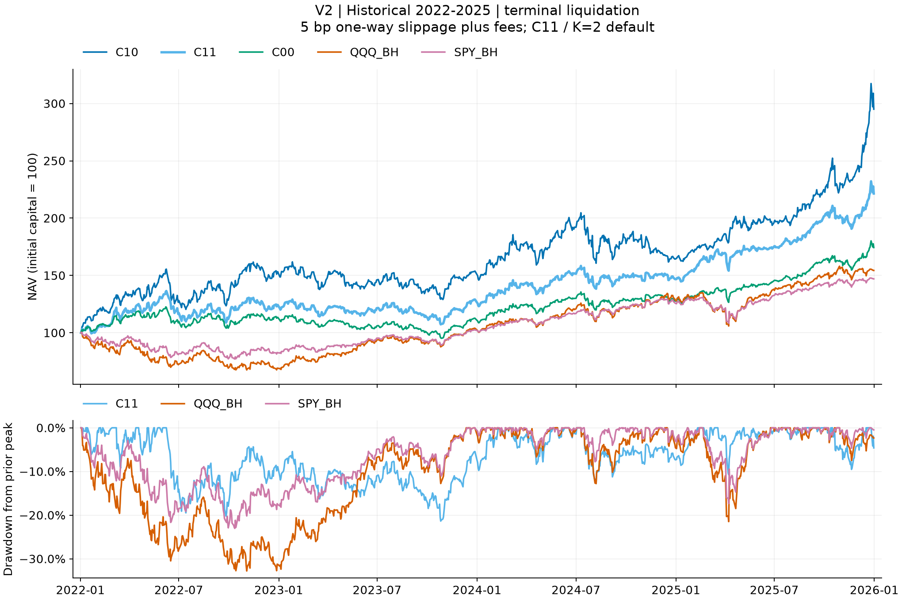
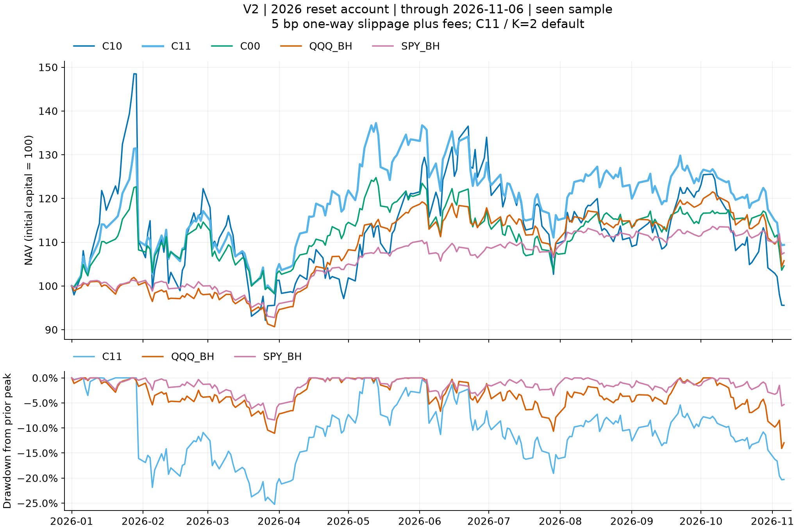

# V2 标准历史与 2026 已见样本结果

当前默认是 **C11 / K=2**：历史 2022 前 AUM 条件池（34 风险资产 + SHY），21 个经济风险组，每组最多 1 个持仓。用户于2026-11-11明确将默认从C10前1只改为C11前2只；C10与C00仍为完整对照。这是看过历史结果后的规则选择，不是新的独立样本外确认。

**默认 C11，5 bp 单边滑点，2026 重置账户累计收益 9.39%，最大回撤 25.25%。** 回撤仍然较大；成为研究标准不代表获准实盘。2026 已参与研究，不能再称全新 OOS。历史 AUM 证据仅支持 conditional PIT，不能抹去候选集构造、存活与反复研究偏差。

口径：所有账户初始 $50,000，目标部署预算 95%（价格漂移可超过该比例），同一费用表，另计 5/20 bp 单边滑点，含分红、无税、现金不计息。历史账户 2025-12-31 开盘终清；2026 重置账户从 $50,000 起算；连续账户的 2026 收益以其自身 2025-12-31 收盘 NAV 为分母，之前未终清。因此连续账户 2025 年数据与历史终清账户并非相同结算口径。

年度和月度收益包含首个交易日相对期初资本的变化；最大回撤也包含期初资本。2026 截至 2026-11-06，11 月是不完整月。2026 收益不年化，CAGR 留空；波动率与 Sharpe 仅按日收益标准化（252 日、样本标准差、无风险利率 0）。历史 CAGR 使用 252/交易日数；年度收益使用实际期末/期初比值。

## 历史 2022–2025（期末终清） · 5 bp 单边滑点

| 策略 | 累计收益 | 最大回撤 | CAGR | 期初权益 | 期末权益 |
|---|---:|---:|---:|---:|---:|
| C10 | 195.06% | 22.55% | 31.24% | $50,000.00 | $147,530.17 |
| C11 | 121.46% | 21.36% | 22.11% | $50,000.00 | $110,728.28 |
| C00 | 74.36% | 22.32% | 14.99% | $50,000.00 | $87,179.62 |
| QQQ_BH | 54.36% | 32.79% | 11.52% | $50,000.00 | $77,181.34 |
| SPY_BH | 47.02% | 23.04% | 10.17% | $50,000.00 | $73,512.36 |
| SPY60_IEF40 | 25.33% | 19.80% | 5.84% | $50,000.00 | $62,666.49 |

## 历史 2022–2025（期末终清） · 20 bp 单边滑点

| 策略 | 累计收益 | 最大回撤 | CAGR | 期初权益 | 期末权益 |
|---|---:|---:|---:|---:|---:|
| C10 | 185.65% | 22.54% | 30.17% | $50,000.00 | $142,825.69 |
| C11 | 113.10% | 22.13% | 20.94% | $50,000.00 | $106,549.06 |
| C00 | 67.39% | 23.48% | 13.82% | $50,000.00 | $83,695.39 |
| QQQ_BH | 54.00% | 32.83% | 11.46% | $50,000.00 | $77,001.04 |
| SPY_BH | 46.68% | 23.07% | 10.10% | $50,000.00 | $73,339.59 |
| SPY60_IEF40 | 24.78% | 20.00% | 5.72% | $50,000.00 | $62,392.07 |

## 2026 重置账户 · 5 bp 单边滑点

| 策略 | 累计收益 | 最大回撤 | CAGR | 期初权益 | 期末权益 |
|---|---:|---:|---:|---:|---:|
| C11 | 9.39% | 25.25% | — | $50,000.00 | $54,696.42 |
| SPY_BH | 7.56% | 8.41% | — | $50,000.00 | $53,780.83 |
| QQQ_BH | 5.78% | 14.09% | — | $50,000.00 | $52,887.89 |
| C00 | 4.59% | 19.94% | — | $50,000.00 | $52,292.98 |
| SPY60_IEF40 | 4.06% | 5.59% | — | $50,000.00 | $52,031.04 |
| C10 | -4.43% | 37.95% | — | $50,000.00 | $47,785.19 |

## 2026 重置账户 · 20 bp 单边滑点

| 策略 | 累计收益 | 最大回撤 | CAGR | 期初权益 | 期末权益 |
|---|---:|---:|---:|---:|---:|
| C11 | 8.57% | 25.23% | — | $50,000.00 | $54,283.86 |
| SPY_BH | 7.42% | 8.42% | — | $50,000.00 | $53,709.86 |
| QQQ_BH | 5.63% | 14.10% | — | $50,000.00 | $52,817.20 |
| SPY60_IEF40 | 3.89% | 5.60% | — | $50,000.00 | $51,944.73 |
| C00 | 3.67% | 19.94% | — | $50,000.00 | $51,835.87 |
| C10 | -5.05% | 37.94% | — | $50,000.00 | $47,475.51 |

## 连续账户的 2026 YTD · 5 bp 单边滑点

| 策略 | 累计收益 | 最大回撤 | CAGR | 期初权益 | 期末权益 |
|---|---:|---:|---:|---:|---:|
| C11 | 13.05% | 25.26% | — | $109,719.23 | $124,035.80 |
| SPY_BH | 7.99% | 8.22% | — | $73,033.28 | $78,870.26 |
| C00 | 7.53% | 19.90% | — | $86,306.22 | $92,801.36 |
| QQQ_BH | 6.79% | 14.13% | — | $76,591.63 | $81,793.99 |
| SPY60_IEF40 | 4.40% | 5.63% | — | $62,387.38 | $65,133.98 |
| C10 | -0.63% | 37.95% | — | $145,405.90 | $144,489.42 |

## 连续账户的 2026 YTD · 20 bp 单边滑点

| 策略 | 累计收益 | 最大回撤 | CAGR | 期初权益 | 期末权益 |
|---|---:|---:|---:|---:|---:|
| C11 | 12.47% | 25.26% | — | $105,727.68 | $118,913.43 |
| SPY_BH | 8.00% | 8.22% | — | $72,962.55 | $78,799.53 |
| C00 | 6.88% | 19.96% | — | $82,975.79 | $88,684.21 |
| QQQ_BH | 6.80% | 14.14% | — | $76,521.00 | $81,723.35 |
| SPY60_IEF40 | 4.39% | 5.65% | — | $62,205.47 | $64,937.52 |
| C10 | -1.08% | 37.91% | — | $140,970.62 | $139,452.39 |

## 历史年度 C11 / QQQ / SPY · 5 bp

| 年度 | C11 收益 / 回撤 | QQQ 收益 / 回撤 | SPY 收益 / 回撤 |
|---|---:|---:|---:|
| 2022 | 24.32% / 20.23% | -30.88% / 32.79% | -17.39% / 23.04% |
| 2023 | 3.21% / 16.83% | 49.77% / 10.05% | 23.85% / 9.18% |
| 2024 | 14.36% / 12.62% | 23.84% / 12.78% | 22.80% / 7.79% |
| 2025 | 50.92% / 10.76% | 20.41% / 21.48% | 17.01% / 17.35% |

## 可复核文件

- [summary.csv](summary.csv)：36 行；连续账户只汇总 2026 YTD。
- [annual.csv](annual.csv) 和 [monthly.csv](monthly.csv)：保存完整账本的年度/月度切片，按 cohort、成本与 account 明确区分。
- [verification.json](verification.json)：全部来源哈希与归档指标核对。
- 已验证 36 账户、348 来源文件、1260 个归档统计值。
- 来源：[账户清单](../ACCOUNTS.json)、`standard/reference/<account>/` 原生五账本；[标准配置](../STRATEGY.json)。
- 离线重建：`python -m c10standard.report`；报告不运行 native，不请求 API。
